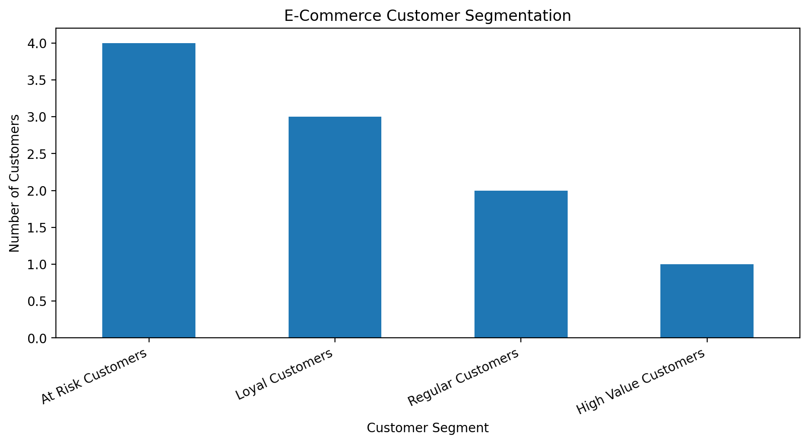

# E-Commerce Customer Segmentation Using RFM Analysis

A Python-based data analytics project that analyses e-commerce transaction data and groups customers using Recency, Frequency and Monetary (RFM) metrics.

## Project Overview

Businesses can use customer purchase history to understand customer behaviour, identify valuable customers and determine which customers may need targeted engagement.

This project demonstrates a basic RFM workflow using transaction data, Python and pandas.

## Objectives

- Calculate customer recency, frequency and monetary value.
- Assign RFM scores to customers.
- Classify customers into illustrative segments.
- Generate a customer-level CSV report.
- Visualise customer segment distribution.

## Technology Stack

- Python
- pandas
- Matplotlib
- CSV data processing
- Git and GitHub

## Project Structure

```text
ecommerce-customer-segmentation/
├── README.md
├── rfm_analysis.py
├── transactions.csv
└── customer_segments.png
```

The analysis also generates `customer_segments.csv` when executed.

## Methodology

### 1. Recency
The number of days since the customer's most recent purchase.

### 2. Frequency
The number of transactions associated with the customer.

### 3. Monetary Value
The sum of the customer's transaction amounts.

### 4. RFM Scoring
Customers receive scores from 1 to 5 for each metric. Higher scores represent better values for the scoring direction used.

### 5. Customer Segmentation
The script assigns illustrative customer categories based on RFM scores, including loyal, high-value, at-risk and regular customers.

## Visualisation

The project generates a bar chart showing the number of customers in each segment.



## How to Run

1. Install Python 3.
2. Install the required packages:

   ```bash
   pip install pandas matplotlib
   ```

3. Clone this repository:

   ```bash
   git clone https://github.com/Taarushi-byte/ecommerce-customer-segmentation.git
   ```

4. Open the project directory:

   ```bash
   cd ecommerce-customer-segmentation
   ```

5. Run the analysis:

   ```bash
   python rfm_analysis.py
   ```

The script reads `transactions.csv` and creates `customer_segments.csv`.

## Dataset

The included transaction records are fictional demonstration data. They do not represent real customers or a production business.

## Limitations and Future Improvements

- Test the workflow with larger, realistic datasets.
- Improve handling of missing or invalid records.
- Make the analysis date configurable.
- Add interactive visualisations.
- Refine segment definitions using business requirements.
- Add automated tests and reproducible analysis.

## Author

Tarushi Mahesh

Python | SQL | Data Analytics | Customer Segmentation

